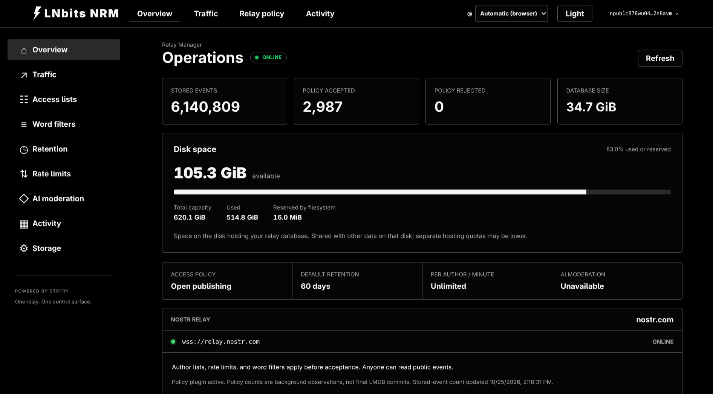

# LNbits NRM

**LNbits Nostr Relay Manager** — strfry and a management UI in one Docker container.

Manage author and word lists, retention, publish limits, traffic, disk space and optional background AI moderation. Sign in with a Nostr extension. Includes light/dark themes and 10 languages with browser-language detection.

<a href="docs/images/overview.png"></a>

## Setup

Requires Docker with Compose. These steps create a **new relay**; for an existing database, read [migration instructions](docs/deployment.md#host-directory-storage) first.

```bash
git clone https://github.com/lnbits/aedos_strfry.git
cd aedos_strfry
cp .env.example .env
```

Edit `.env`, replacing the example npub with your **public** key:

```env
ADMIN_NPUBS=npub1your_actual_public_key
PUBLIC_ORIGIN=http://localhost:3000
RELAY_URL=ws://localhost:7777
AI_MODERATION_ENABLED=false
```

```bash
docker compose build --pull
docker compose run --rm -T setup </dev/null
docker compose up -d --no-build
```

Open **http://localhost:3000** on the Docker host and connect your Nostr extension, such as [nos2x](https://chromewebstore.google.com/detail/nos2x/kpgefcfmnafjgpblomihpgmejjdanjjp). The relay listens on port **7777**. For a public server, configure your HTTPS/WSS addresses and [reverse proxy](docs/deployment.md#https-with-caddy).

Events live in `./strfry-db/`; settings live in `./data/`. Keep both directories and `.env` when updating.

## Defaults

- **Retention:** `0` keeps events forever. A finite period enables rolling cleanup.
- **Publish limits:** 60/minute and 1,000/hour per author. Set both to `0` in **Rate limits** for unrestricted publishing.
- **AI:** the setup above locks it off, including for admins. See the [security review](SECURITY_REVIEW.md) before enabling media review.

Saved policies survive restarts and updates.

## Manage and update

| Task | Command |
| --- | --- |
| Logs | `docker compose logs -f aedos` |
| Stop | `docker compose down` |
| Start or apply `.env` changes | `docker compose up -d --no-build aedos` |

For more admins, add comma-separated public npubs to `ADMIN_NPUBS`, then apply the `.env` changes. This briefly restarts the relay; every listed admin has full management access.

To update, keep your existing `.env` and storage:

```bash
git pull
docker compose build --pull
docker compose up -d --no-build
```

Back up both data directories with the container stopped. Never run two relay deployments against the same database.

## More

[Deployment, backups and migration](docs/deployment.md) · [Policy and feature reference](docs/reference.md) · [Development and tests](docs/development.md) · [Environment options](.env.example) · [Security review](SECURITY_REVIEW.md)
